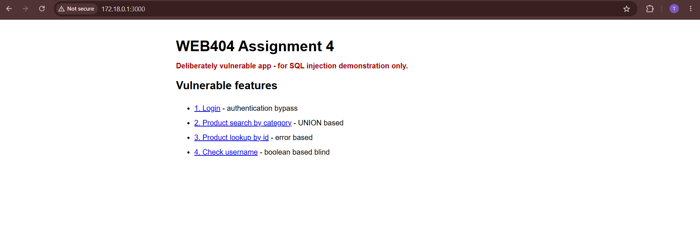
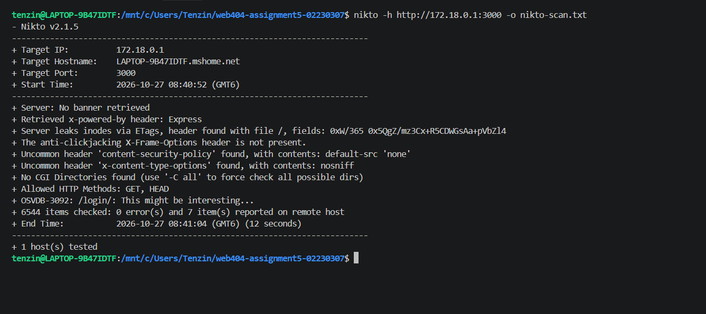
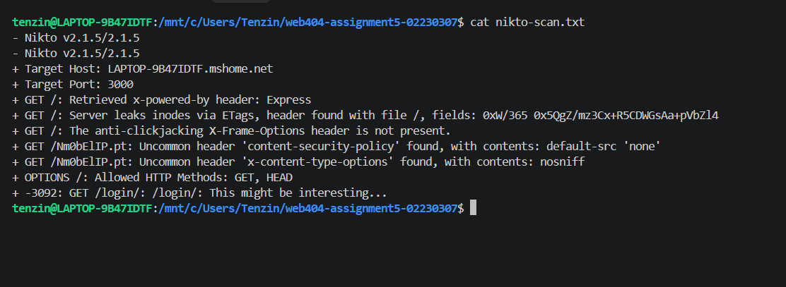
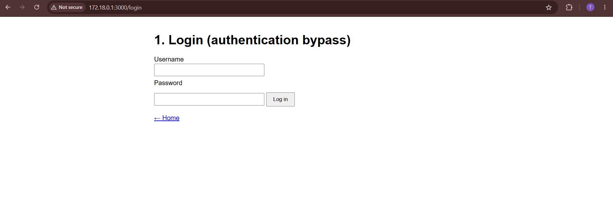

# WEB404 Secure Coding Practices — Assignment 5 Report

**Student:** Tenzin Namgay (Cuney)
**Student ID:** 02230307
**Topic:** Web Server Scanning with Nikto

## Overview

I used Nikto to scan the SQL injection app I built for Assignment 4
(Node.js + Express + SQLite) while it was running locally on port
3000. Nikto reported 7 findings. This report explains what Nikto is,
how I ran the scan, and what each finding means: whether it is a real
risk or just information, and how to fix it where a fix is needed.

## What is Nikto?

Nikto is an open source command line web server scanner. It sends
thousands of requests to a target (6,544 in my scan) and checks the
responses for:

- missing or unusual security headers
- information the server gives away about itself (software, versions)
- dangerous HTTP methods
- default, old or "interesting" files and folders (admin pages, login
  pages, backups)
- known problems in outdated server software

Nikto is a **configuration scanner**, not an application logic tester.
It looks at how the server is set up and what it responds with. It does
not fill in forms or try payloads like `admin' --`. That matters here:
my Assignment 4 app was built to be vulnerable to SQL injection, and
Nikto did not detect that at all (see Finding 7).

Nikto is also very noisy. It makes no attempt to hide, so it should
only be run against systems you own or have permission to test. Here
the target was my own app on my own laptop.

## Target and Command

| Item | Value |
|---|---|
| Tool | Nikto v2.1.5 (run from WSL, Ubuntu) |
| Target app | Assignment 4 SQL injection app (Express 4, `npm start`) |
| Target URL | `http://172.18.0.1:3000` |
| Resolved hostname | `LAPTOP-9B47IDTF.mshome.net` |
| Scan time | 2026-10-27, 08:40:52 to 08:41:04 (12 seconds) |
| Result | 6,544 items checked, 0 errors, 7 items reported |



The app ran on Windows at `localhost:3000`. Nikto ran inside WSL, where
`localhost` points to the Linux VM, not Windows. So I scanned
`172.18.0.1`, which is the address of the Windows host as seen from
WSL. It is the same app on the same machine.

Command:

```bash
nikto -h http://172.18.0.1:3000 -o nikto-scan.txt
```

- `-h` sets the target host (here a full URL including the port)
- `-o` saves the findings to a file; the `.txt` extension picks the
  plain text format



The saved output file ([nikto-scan.txt](../nikto-scan.txt)):



The console also showed two lines that are not counted as findings:
"No banner retrieved" (Express does not send a `Server` header) and
"No CGI Directories found". Both are normal for an Express app.

## 1. X-Powered-By Header Reveals Express

### What Nikto reported
```
+ GET /: Retrieved x-powered-by header: Express
```

### What it means
Every response from the app includes the header
`X-Powered-By: Express`. Express adds it by default. It tells anyone
who looks that the backend is Node.js with Express.

### Risk
**Low (information disclosure).** This header alone cannot be used to
break in. But it saves an attacker the work of finding out what the
server runs, so they can go straight to Express or Node.js specific
attacks and known vulnerabilities. It serves no purpose for real users.

### Fix
Turn off the header in Express:

```js
app.disable('x-powered-by');
```

Or use the `helmet` middleware, which removes it and adds several of
the missing headers from the findings below.

## 2. ETag Header "Leaks Inodes"

### What Nikto reported
```
+ GET /: Server leaks inodes via ETags, header found with file /,
  fields: 0xW/365 0x5QgZ/mz3Cx+R5CDWGsAa+pVbZl4
```

### What it means
An ETag is a short value the server sends with a response so the
browser can cache it and later ask "has this changed?". Some older
servers, mainly Apache, built the ETag from the file's **inode
number** (its internal ID on disk). That leaks details of the server's
file system, and in a cluster of servers it can help identify which
machine answered.

### Risk
**Informational, and a false positive here.** Express does not use
inodes. Its ETag is `W/"<body length in hex>-<hash of the body>"`.
The fields Nikto printed match that exactly: `W/` marks a weak ETag,
`365` is the length of the home page in hex (869 bytes), and the rest
is a hash of the page content. Nothing about the file system is
exposed. Nikto 2.1.5 is an old version, and this check was written
for Apache, so it misreads Express's ETag format.

### Fix
No fix needed. ETags are useful for caching and Express's ETags are
safe. If a policy required removing them anyway, `app.set('etag',
false)` turns them off.

## 3. Missing X-Frame-Options (Clickjacking)

### What Nikto reported
```
+ GET /: The anti-clickjacking X-Frame-Options header is not present.
```

### What it means
Without `X-Frame-Options` (or the newer CSP `frame-ancestors` rule),
any other website can load my app inside an invisible `<iframe>`. An
attacker could put their own buttons or text on top and trick a user
into clicking something in my app without realising it. This is called
**clickjacking**.

### Risk
**Low to Medium. This is a real issue.** The app has a login form and
pages that act on what the user submits, which are the usual targets
for clickjacking. The impact is limited for a local coursework app,
but on a real site this header is expected.

### Fix
Tell browsers not to let other sites frame the app:

```js
app.use((req, res, next) => {
  res.setHeader('X-Frame-Options', 'DENY');
  res.setHeader('Content-Security-Policy', "frame-ancestors 'none'");
  next();
});
```

`helmet` sets the same protection by default.

## 4. Content-Security-Policy Header Found

### What Nikto reported
```
+ GET /Nm0bElIP.pt: Uncommon header 'content-security-policy' found,
  with contents: default-src 'none'
```

### What it means
`/Nm0bElIP.pt` is a random path Nikto requested on purpose to see how
the server handles a page that does not exist. My app has no such
route, so Express's built-in "Cannot GET" 404 handler answered it. That
handler adds a strict Content Security Policy (`default-src 'none'`),
which tells the browser not to load any scripts, styles or images on
the error page.

Nikto flags it only because it is an "uncommon" header. This is not a
vulnerability. It is a protective header.

### Risk
**Informational (a good header).** But it shows a gap: the CSP is only
on Express's default 404 page. My own pages (`/`, `/login`,
`/products`, etc.) do not send a CSP at all, otherwise Nikto would
have reported it on `/`. A CSP on real pages is one of the main
defences against cross-site scripting (XSS).

### Fix
Nothing to fix on the 404 page. For the real pages, add a CSP that
fits the app, for example `default-src 'self'` via `helmet` or a
`Content-Security-Policy` header.

## 5. X-Content-Type-Options Header Found

### What Nikto reported
```
+ GET /Nm0bElIP.pt: Uncommon header 'x-content-type-options' found,
  with contents: nosniff
```

### What it means
This is also from Express's 404 handler. `X-Content-Type-Options:
nosniff` tells the browser to trust the `Content-Type` the server sends
and not try to "sniff" (guess) the type from the content. Without it,
a browser might run an uploaded text file as JavaScript, for example.

### Risk
**Informational (a good header).** Same gap as Finding 4: it only
appears on the default 404 page, not on the app's real pages.

### Fix
Send `X-Content-Type-Options: nosniff` on every response. `helmet`
does this by default.

## 6. Allowed HTTP Methods: GET, HEAD

### What Nikto reported
```
+ OPTIONS /: Allowed HTTP Methods: GET, HEAD
```

### What it means
Nikto sent an `OPTIONS` request to ask the server which HTTP methods
it accepts on `/`. Express answered automatically from the routes
defined for that path. `/` only has a `GET` route, and Express handles
`HEAD` with the same route, so the answer was `GET, HEAD`.

Nikto checks this because methods like `PUT`, `DELETE` or `TRACE`
could let an attacker upload or delete files, or are used in some
older attacks such as cross-site tracing.

### Risk
**Informational. No risk.** Only safe, read-only methods are allowed on
`/`. (The `/login` route also accepts `POST` for the login form, which
is expected.)

### Fix
No fix needed.

## 7. /login/ "Might Be Interesting"

### What Nikto reported
```
+ -3092: GET /login/: /login/: This might be interesting...
```

(The `3092` is the OSVDB ID for this check, shown as `OSVDB-3092` on
the console. OSVDB was a vulnerability database that has since shut
down.)

### What it means
Nikto has a list of common paths, and `/login/` is one of them. It
found that the path exists and flagged it as worth a closer look. This
is not a vulnerability by itself. It is a hint for the tester: login
pages are where brute force, weak passwords and injection attacks are
usually aimed.

### Risk
**Informational as a Nikto finding, but it points at a real risk.**
`/login` is exactly the route I attacked in Assignment 4 with the
`admin' --` authentication bypass. Nikto found the door but did not
try to open it. It does not test forms for SQL injection, so it gave
no warning that this route had been vulnerable. A clean Nikto result
does not mean an app is free of injection flaws. That needs manual
testing or a tool built for it (for example sqlmap or OWASP ZAP).



### Fix
Nothing to change in the server configuration. For the login page
itself, the important fixes are:

- parameterized queries (already done in Assignment 4, Stage 2)
- rate limiting or lockout after repeated failed logins, to slow down
  brute force
- hashing stored passwords (the Assignment 4 app stores them in plain
  text for demo purposes)

## Summary

| # | Finding | Real risk? | Severity | Fix |
|---|---|---|---|---|
| 1 | `X-Powered-By: Express` | Yes, minor | Low | `app.disable('x-powered-by')` or helmet |
| 2 | ETag "inode leak" | No (false positive) | Info | None needed |
| 3 | No `X-Frame-Options` | Yes | Low–Medium | `X-Frame-Options: DENY` / `frame-ancestors 'none'` |
| 4 | CSP on 404 page | No (good header) | Info | Add CSP to real pages too |
| 5 | `nosniff` on 404 page | No (good header) | Info | Add `nosniff` to real pages too |
| 6 | Methods: GET, HEAD | No | Info | None needed |
| 7 | `/login/` found | Points to a real risk | Info | Secure the login logic (done in A4) |

Overall, Nikto found two real but minor issues, both missing or
unneeded HTTP headers (Findings 1 and 3), plus a gap in security
headers on normal pages (Findings 4 and 5). Adding the `helmet`
middleware to the Express app would fix Findings 1, 3, 4 and 5 in one
line.

The bigger lesson is what Nikto **missed**. The app's real weakness
from Assignment 4 was SQL injection in its routes, and Nikto cannot see
that kind of bug because it only looks at the server's setup and
responses. Nikto is useful as a quick first pass for configuration and
header problems, but it has to be combined with application testing
to give a full picture of a site's security.
